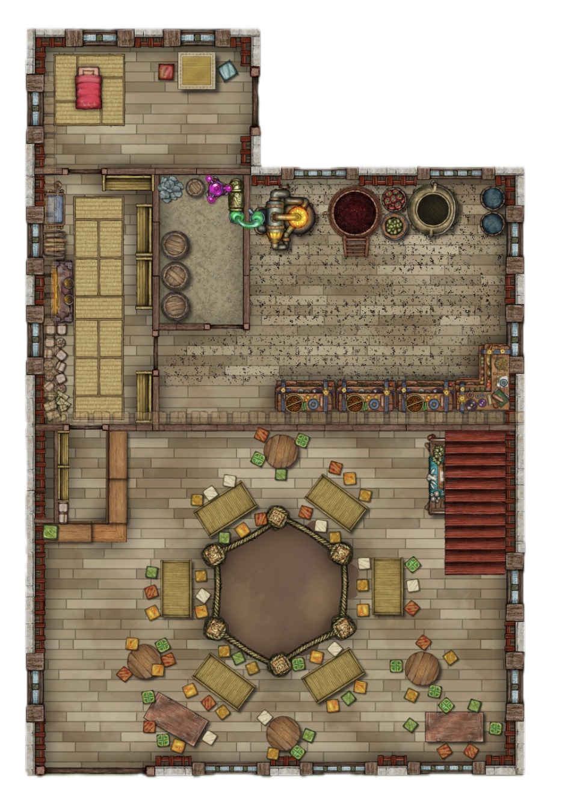
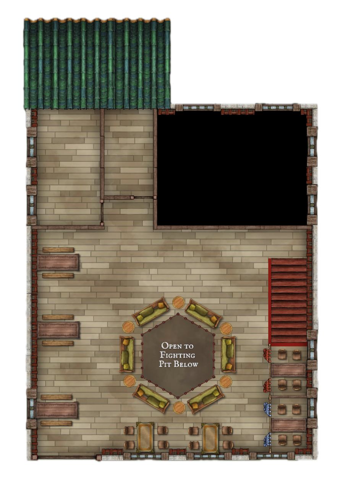

# The First Church

> The first church Alben actually builds: a **two-story property in the red light district of Goka**, bought for 4,500 gp with the Qualifiers money and turned into a bar, a pit, a still, and a shrine to **C²** (Cayden Cailean: Alcohol² + Battle²). This is the real one. Everything in [plans/](plans/) is a design study for what the church might become later, and where those files disagree with this one, **this file wins**.

---

## What This Place Is

Alben did not go looking for the red light district. He went looking for a building he could afford that was big enough for a bar, a hole in the floor, and a still, and the only landlords in Goka who would sell to an orc with a duck on his shoulder and no references were in the one part of the city where nobody asks for references.

He stayed because of the district, not in spite of it. The people who work this street are, by the plain reading of his god's edicts, the people he is supposed to aid: **drink, aid the oppressed, seek glory and adventure.** There is a lot to drink here, a lot of oppression, and a fight in every alley.

The house also came with **cats**. They are dead, they are friendly, and they were here first (see [The Cats](#the-cats)). The house is a **church** in every way that matters to him and in none that the district's licensing officials would recognize. The sign says **the First Church**. The regulars say *the Church*, and the neighbors say *the orc's place*. The staff, such as it is, are the beginning of **C³**: the clergy of C². At this point that is Alben, Solomon, and whoever has decided to stay.

---

## The Property

A narrow, deep **two-story** building on a street of other narrow, deep two-story buildings, **55 feet wide and 70 feet deep** (3,850 square feet a floor, 7,700 across both), with a flat roof and a back yard the size of a cart. Timber frame over a stone ground floor, shared walls on both sides, and a front door under a paper lantern like every other door on the street. Alben has not yet replaced the lantern. Everything else he has.

| Floor | Use |
|---|---|
| **Ground floor** | The public room with the Pit and the Bar, the Still and its vats, a cask store, the kitchen, and Alben's bedroom. |
| **Second floor** | A pit-view gallery open to the Pit below, plus two small rooms in the north-west corner, kept for future use. |
| **Roof** | Green-tiled over the north-west wing. The second way out is the roof ladder. |

---

## Floor Plans

The footprint is **L-shaped**: a main block with a **north-west wing** that sticks out past the rest of the building.

**Ground floor**

**Second floor**

**Ground floor, north to south:**

| Area | What the plan shows |
|---|---|
| **North-west wing** | A bedroom: a red-blanketed bed on tatami matting, a small rug and table, and floor cushions. This is **Alben's room**, which Solomon shares. |
| **Left strip** (west side) | A long room of **tatami mats** in two rows, with a wash basin and a stove or hearth on the west wall and stacked bundles and crates beside it. This is the **kitchen** (see below). |
| **Ruining Room** (middle) | A walled room with **three barrels**, sacks, and a glowing purple-and-green contraption on a bench. This is his secret Rambui process. |
| **The Still** (north-east) | The large back room: a **copper still with a lit firebox**, a **big red fermenting vat on a ladder stand**, a large cauldron, baskets of **red and green fruit**, and two blue barrels. It is open to 2nd story above. |
| **Back counter** | A row of four ornate trunks and an L-shaped counter along the wall dividing the Still room from the public room. This is where the stock and the Cabinet are kept. |
| **Public room** (south half) | The **hexagonal Pit** in the middle, with the **L-shaped Bar** in the north-west corner, and tables all around the Pit. |
| **Stairs** | A red-carpeted stair on the east wall of the public room, up to the second floor. |

**Second floor:**

| Area | What the plan shows |
|---|---|
| **Gallery** | Most of the floor. A hexagonal opening labeled **"Open to Fighting Pit Below,"** ringed by **six sofas and round tables**, with long plank tables and benches along the west wall and more tables with chairs along the south wall. |
| **East side** | A stair landing, with a **railing hung with red and blue banners** and two rows of tables with stools behind it. |
| **North-west wing** | **Two small, empty rooms** divided by a partition, under a green tile roof. |
| **North-east block** | Open to first floor below. |

> **GM Note — reading the plans.** I interpreted these from the images, so confirm them against what you meant:
> - **The black block** is read as the **double-height ceiling over the Still**, which has no second floor above it. If it's something else (an unbuilt space, a light well), change this.
> - **The street door** isn't marked on either plan. It's on the **south wall, at the bottom-left (south-west) corner**, a double red door (see [The Street Door](#the-street-door)).
> - **Confirmed by you:** the black block is the Still's open ceiling, the tatami strip is the kitchen, the two upstairs rooms are for future use, and Solomon shares Alben's room.
> - The maps don't show a scale, so I'm taking the pit as **about 15 feet corner to corner**.

---

## Ground Floor

### The Bar

The first thing through the door: an **L-shaped bar** of reclaimed ship's timber in the north-west corner of the public room, with **twelve feet of working counter** on the long side, long enough for one man to work alone and no longer. Alben can see every table from behind it and every inch of the Pit from the end of it. He built it that way on purpose, and it's the same twelve feet he will keep at every church after this one.

Behind it: a bamboo-handled shelf of **bamboo cups, mugs, and glasses of every standard bar type**, each one burned with the **C²** mark. He pours **Rambui** in a shot glass, always. Everything else goes in the glass that fits the drink. The customer chooses the drink, and Alben chooses the glass. See [The Ritual](../rambui/liquor.md#the-ritual-lets-have-a-drink) for the full ceremony. In a district where most drinks are watered and most cups are cracked, a full pour in a clean bamboo cup is a statement.

### The Pit

A **hexagonal ring** in the middle of the public room, about **fifteen feet across**, with a thick **rope strung between six knotted posts** and a bare earth floor Alben rakes himself. The second-floor gallery opens onto it from above, so it's watched from two levels. Bouts are for anyone who wants one, with two rules everyone learns the first night:

1. **Nobody dies in my house.**
2. **Nobody stays broken past sunup.** (This is the [Nightly Promise](plans/littlechurch.md#the-nightly-promise), and in this district it gets used.)

Fighters here are mostly the district's own: bouncers, dock hands, off-duty guards, and the occasional debt-bound brawler who fights for someone else's purse. Alben notes which ones those are.

### The Shrine

The shrine is the **altar under the stairs**. The stair on the east wall climbs over a space shaped like a **right triangle**, and Alben built the shrine to fill it, because the shape is the creed of C²:

| Part of the triangle | What it is | What it stands for |
|---|---|---|
| **The base** (floor line) | A low shelf and rail at floor level, where drinks are left, poured, and shared. A tankard-shaped icon sits on it, and the nightly saucer of Rambui stands here. | **Alcohol.** |
| **The vertical wall** (beside the stairs' foot) | The **Ladder**: a list of champions carved or painted on the wall, with room left to add names. | **Battle.** |
| **The hypotenuse** (the underside of the stairs) | The **altar** itself, a sloped surface that follows the angle of the stair above it. | **C²**, the sum of the two, where they meet. |

The Ladder is a ladder in the fighting-game sense: **champions of the Pit, ranked.** A name goes up when someone wins a bout the house counts, and the order changes as challengers beat the ones above them. Alben paints new names himself. Anyone can challenge a name on the Ladder, and the Pit is where it's settled.

Anyone may leave a drink at the base for the god. Alben prays here the way he brews and fights: out loud, mid-task, more conversation than ceremony. He calls the god **C²** to his face, and the god has not objected.

> **GM Note.** How you rank the Ladder is open: bouts won, a points tally, or Alben's own call. The right-triangle shape and the Ladder's name are the fixed parts. If a rival name should appear, or Alben's own should, that's a hook for the table. It's also another place the **cats** sleep.

### The Still

The large **north-east back room**, with a doorway that doesn't lock, holding **Alben's still**: squat, copper, and patched in three places, with a big red fermenting vat and a cauldron beside it (see [rambui.md](../rambui/rambui.md)). It's open to the roof above, with no second floor over it. This is the first place Alben brews Rambui from a fixed floor instead of a saddle, so it's cluttered, it smells of scorched sugar and rambutan pulp, and nobody goes in without being asked. **Solomon's perch** is beside the still, where he does the QA taste test on every batch.

### Floors, Tables, and Chairs

Everything inside is **red light district cheap**, and Alben has not tried to hide it. The point of the place is the people, and the furniture just has to survive them.

**The floor.** Warped, mismatched **pine planks** over the old stone, nailed down by at least three previous owners and patched with whatever was nearest. Between the planks and along the walls the gaps are wide enough to lose a coin in. Near the door the boards are **dark and sticky from decades of spilled drinks**, and the stain has gone past cleaning and into the grain. Near the bar, someone laid **cheap woven reed matting** over the worst boards. It's already curling at the edges. The Pit is the one clean surface: raked sand, a hand's depth, in a ring of packed earth with a rope around it.

**The tables.** About **twelve** of them, none of which match: a few **low tables** meant for sitting on the floor, a few **rough plank tables** on trestles, and two **barrels with a board across them**. They're scarred, ring-marked, and carved with names, tallies, and one eloquent drawing of a duck. Two are bolted down, because they were the only ones that survived the first week. Each has a **tin lamp** and a chipped dish for coin.

**The seating.** **Stools and benches**, mostly. There are perhaps **thirty stools** in at least six different heights, a pair of **long benches** along the walls, and **three chairs** with backs, which regulars treat as a status symbol. A couple of the stools have been replaced since Alben moved in, because customers his size are not a design consideration of the district. The two nearest the bar are **reinforced with iron bands**, and nobody has asked why.

**The walls and light.** Plaster stained by smoke and lamp oil, hung with **paper lanterns** in faded reds and yellows (the district's trademark, and the cheapest light there is), and one **fishing net** with a few unidentifiable trophies. There are no windows on the street side. The only natural light comes through the **door and a skylight over the Pit**.

**The smell.** Old smoke, spilled liquor, wet wood, and, since Alben moved in, a steady undertone of scorched sugar and rambutan from the back room.

#### Keeping It Clean: *Prestidigitation*

Cleaning is done with **magic, not mops**. Alben has **Prestidigitation** prepared every day (see [spells.md](../spells.md#prepared-combat-loadout)), and he uses its **tidy** option at close:

- He walks the room at the end of the night, a cup in one hand, and **cleans the tables, the benches, and a patch of floor at a time**, one small stretch for each cast. It takes about as long as the walk.
- The **spilled-drink stain near the door is the one thing he leaves alone.** He could clean it, and hasn't, and the regulars have begun to treat it as a landmark.
- It cleans the **floor**, not the **damage**. The broken stools, curling mat, and warped boards are still there in the morning.
- The cats like a clean table, and they appear to knock over drinks on the freshly cleaned ones first.

> **GM Note — Mechanics.** *Prestidigitation* cleans a small amount of material per cast (about 1 cubic foot, so a table, a stool, or a few square feet of floor). It's a cantrip, so it has no daily limit, but the room is too big to clean in one round. Treat the closing clean as a **downtime beat of about 10 minutes**, not a roll. If the Aspirants or other staff are available, they can't do it. They don't have the spell, and mops are what the district does everywhere else.
>
> The stain, the furniture, and the floor are **assumptions** that can be changed. What matters is the look: **cheap, mismatched, scarred, and clean by magic.**

---

## The Cats

The building is **haunted by spectral cats**. Nobody told Alben when he bought it, and he has stopped asking whether that explains the price.

There are somewhere between **six and a dozen**, and nobody has counted them twice with the same result. They are pale and slightly translucent, they glow faintly when the lights are low, and they pass through walls, furniture, and Alben. They don't speak, haunt anything, or frighten anyone who isn't already frightened. They sit on the bar, sleep under the stairs on the altar, watch the Pit from the rafters, and follow whoever looks the most tired.

**They knock things over.** About once a night, at the worst moment, a cat reaches out a paw and **pushes a drink off the bar, off a table, or out of someone's hand**. They never touch the Pit, the still, or anything that's bleeding. They only go after full cups.

### How Alben Handles It

- **He pours another one, free.** Cats count as part of the house, and a drink lost to a cat is on the house. This is the only time Alben ever lets a drink spill, and it fits the one anathema he takes seriously: **never waste alcohol**. A cat's spill isn't waste, because the cat was always going to have it.
- **He leaves a saucer at the shrine.** Every night, a full saucer of Rambui. By morning it's empty and the saucer is dry.
- **He talks to them.** Out loud, mid-task, more conversation than ceremony, the same way he talks to the god. He's decided the two aren't unrelated.
- **Solomon is not worried.** The Collar of Empathy gives Alben a clear read of the duck's mood around the cats, and it is **curious and a little smug**, never afraid. The cats have never touched the duck, and Solomon has never been seen to touch them either.

### In Play

> **GM Note — Mechanics.** The cats are **flavor with a nuisance edge**, not a haunt to solve or a hazard. Treat them as friendly, incorporeal, and harmless. They can't be attacked, turned, or banished in any way Alben would accept.
>
> - **The Spill.** Once per night, or whenever a scene wants a beat, a cat knocks over one drink. Call for nothing. The drink is lost, and the owner gets a free replacement. If a PC is holding a drink they care about (a called drink from the Flask of Fellowship, or a Cabinet pour), the GM may give them a **DC 15 Reflex save** to catch it as a free action. Alben never makes the save.
> - **The Ceremony.** A cat may reach for the cup mid-pour, which interrupts [the ritual](../rambui/liquor.md#the-ritual-lets-have-a-drink). A spilled ceremony cup doesn't cost the guest their bonus. Alben starts again, and the guest gets a **free retry** on the beat that broke.
> - **Tired people.** The cats gather around anyone who is hurt, grieving, or exhausted. A GM who wants a quiet hint that someone in the room needs help can have three cats settle on them.
> - **Why they're here** is deliberately left open (see [Hooks](#hooks)).

---

## Second Floor

### The Gallery

Most of the upper floor is a **pit-view gallery** open to the Pit below through a hexagonal gap in the floor. Six cheap sofas and round tables ring the opening, which are the best seats in the house. Long plank tables and benches line the west wall, and tables with stools sit along the south wall and behind the banner railing on the east side. Customers who want to watch without being in the crowd come up here. It's cleaned with the same cantrip as the rest.

### Alben's Room

Alben sleeps on the **ground floor**, in the north-west wing bedroom: a red-blanketed bed on tatami, a small table, and floor cushions. His armor stand and a small shrine shelf (a second, smaller icon of C²) stand by the bed. **Solomon shares the room**, with a perch and a dish of water by the bed and a tiny hatch in the wall onto [Solomon's Road](#solomons-road). It's right beside the kitchen, so Alben hears anyone who needs him.

### The Kitchen

The long **tatami strip** on the ground floor's west side is the **kitchen**: mats, a wash basin, a stove, and stacked bundles and crates. It's **for Alben and the party's food only. No food is served at the church.** The bar pours drink and nothing else.

### The Two Upper Rooms

The two small rooms in the north-west wing upstairs are **empty and kept for future use**.

---

---

## Solomon's Road

Alben builds a duck-scale private route into every venue he owns, so Solomon can leave the building without crossing open floor. This is the first one built from scratch, not cut out of an old chute, and it follows the three rules Alben has always followed:

1. **Every door opens from the inside.** No lock, latch, or bar on any door in this building can hold from the outside against someone who wants to leave. 
2. **Never fewer than two ways out.** The street door and the roof ladder. Solomon's hatch is a third, for Solomon.
3. **No ward may ever stop Solomon leaving.** There are no wards in the First Church. If there were, they would face inward only.

The road itself is a **ten-inch-wide, fourteen-inch-tall** channel inside the wall, running from Alben's room in the north-west wing to the Still room and out under the yard fence. It's ordinary joinery: unlit, unwarded, and **Tiny creatures only**.

In this district the rules mean more than they did anywhere Alben has lived. Most doors on this street lock from the outside. His don't, and everyone who works the street knows it within a month.

---

## The Neighborhood

The district is loud after dark and quiet before noon, which suits a house that does its real business at night. A few things are true on this street, and Alben learns them the hard way:

- **Every door is someone's.** The houses on both sides are run by people who have been here far longer than he has, and who watch the orc with the loud bar the way a landlord watches a new tenant.
- **Debt is the real lock.** Plenty of people on the street can walk out any time and aren't free to. The First Church's rule is that nobody here owes anyone for sleeping on the floor, and that **no hand is laid on anyone leaving**, which the neighbors take as a challenge or a courtesy depending on the neighbor.
- **The watch looks away.** The district pays to be left alone. Alben notices, and has not decided yet what to do about it.
- **The money is real.** The bar and Pit make coin from the first week, because the district has money and nowhere to spend it that isn't a trap.

> **GM Note — names and politics.** No neighbors, madams, or officials are named here on purpose. Name them at the table, or add them to [Hooks](#hooks) as the story needs. The street is deliberately a blank to fill in.

---

## The Street Door

A **double red door** in the south wall at the bottom-left (south-west) corner, under the paper lantern.

| Door | Outside | Inside |
|---|---|---|
| **Left leaf** | marked **A2** | marked **C** |
| **Right leaf** | marked **B2** | marked **C** |

Both leaves open from the inside with a push. Every door in the building does (Solomon's first rule).

---

## Nights: Futons and the Quiet Floor

There's **no separate quiet room**. By late night the **whole building is the quiet area.** **Futons** are stored rolled along the walls, and after the last bout they're pulled out and laid wherever there's floor, on the ground floor and the gallery above.

Many people don't make it that far. They **pass out or get knocked out** and lie where they fell until they're healed or the morning meal. Alben steps round them at close and heals the hurt under the Promise. Nobody is moved, woken, or asked to leave.

- **Nobody pays. Nobody is asked why.** There are no doors to lock, and none that can hold from the outside.
- **Cleaning.** In the morning *Prestidigitation* handles the floor, futons and all, once everyone has gone.
- **Breakfast.** The church serves none. In the morning Alben sends anyone still on a futon to a **local bakery he has a partnership with**, which feeds them. The kitchen stays for Alben's and the party's own food (see [The Kitchen](#the-kitchen)).
- **Cats.** They sleep on whoever looks worst.

> **GM Note — the bakery.** The bakery is deliberately **unnamed** and its terms are open (who pays, whether Alben supplies Rambui or custom, whether it's next door). Name it at the table, or add it to [Hooks](#hooks). Add it to the contacts list if it becomes a regular NPC.

---

## How a Night Works

| Hour | What's happening |
|---|---|
| **Dusk** | The lantern is lit, the Pit is raked, and the first regulars arrive. Alben claps his hands and asks the first stranger **"Let's have a drink. You want the usual?"** |
| **Evening** | The bar fills. Rambui, the Cabinet, and whatever the Flask of Fellowship produces. Bouts start when two people want one. |
| **Late night** | The main bout, the loudest hour. Fights end with a drink, not a grudge. |
| **Later** | **Futons** come out from along the walls and people sleep wherever there's floor (see [Nights](#nights-futons-and-the-quiet-floor)). |
| **Before dawn** | The Pit empties. Alben goes round the floor and heals anyone still hurt under the Promise. |
| **Sunup** | Alben stands on the roof with a cup and toasts the god. The lantern goes out. |

---

## Staff

There isn't any, officially. In practice:

- **Alben, the Host.** Behind the first twelve feet of the bar, every night.
- **Solomon.** Tests every batch, greets every regular, and decides who Alben should be careful of. See the Collar of Empathy in [inventory.md](../inventory.md).
- **Whoever stays.** Someone is nearly always sweeping up, hauling casks, or standing at the end of the bar because it's warmer than the street. If one of them is still there a month later, they've started the road toward becoming an **Aspirant** (see [first-aspirant.md](plans/first-aspirant.md)).

The First Church is where **C³** begins: no ranks, no titles, and no payroll yet, just people who showed up and were not turned away. The full clergy structure in [staff.md](plans/staff.md) is what this grows into, not what it starts as.

---

## Costs

The purchase price is fixed at 4,500 gp. The conversion and stock figures are planning assumptions to tune:

| Item | Cost |
|---|---|
| Purchase of the property | **4,500 gp** |
| Conversion (Pit, bar, still room, kitchen, futon storage) | 600 gp |
| Bar stock and the first batch of casks | 150 gp |
| **Total** | **≈ 5,250 gp** |

Weekly takings are modest to start and rise fast once the Pit's reputation spreads. Alben spends a tenth of the gross on **aid for the oppressed**: free beds, comped drinks, and whatever the street needs that week. He does not think of it as a tithe, and it's the one line he never trims.

---

## Hooks

- **The first neighbor.** Someone from the house next door comes to the bar, orders the usual, and asks politely what Alben thinks he's doing with all those doors.
- **The walk-out.** A worker from a house down the street arrives at the door at three in the morning, still in costume, and asks for a futon. The house comes looking the next night.
- **The debt fighter.** A brawler who loses every bout and is bleeding for someone else's gold. Alben heals them every time, which is how he finds out who holds the debt.
- **The sponsors.** Several of Goka's wealthy and powerful have taken an interest in Alben since the Qualifiers. Which of them knows where the First Church is, and which of them is **pleased**?
- **The cats.** Why does a house this size have a dozen ghost cats? Someone lived here, someone died here, and the district knows who. The cats might be waiting for them, or for something else.
- **The lantern.** Everything on the street answers to the paper lantern over the door. Alben hasn't taken it down. Someone should ask why not.

---

## What Comes Next

The First Church is small by design, and by Alben's measure it's already too big to watch from one spot. It's the first of several, and each of the later builds is sketched in [plans/](plans/):

- [distillerysanctum.md](plans/distillerysanctum.md): the fixed-cellar still design, which this building skips.
- [littlechurch.md](plans/littlechurch.md): the single-room design the First Church replaces.
- [bigchurch.md](plans/bigchurch.md) and [megachurch.md](plans/megachurch.md): where this ends up if it works.
- [staff.md](plans/staff.md) and [first-aspirant.md](plans/first-aspirant.md): the C³ structure this one starts.

---

## Cross-References

- [plans/littlechurch.md](plans/littlechurch.md): The design study for the single-story first venue, and the origin of the Nightly Promise
- [plans/distillerysanctum.md](plans/distillerysanctum.md): The cellar-still plan this building doesn't use
- [plans/staff.md](plans/staff.md): The C³ clergy structure this grows into
- [plans/first-aspirant.md](plans/first-aspirant.md): The first Aspirant, the first to stay
- [liquor.md](../rambui/liquor.md): The drink-offering ritual and the bamboo glassware, which the cats occasionally interrupt
- [rambui.md](../rambui/rambui.md): The brewing process the Still room supports
- [background.md](../background.md): Alben's faith, Solomon, and his voice
- [qualifiers.md](../session-notes.md): Where Alben first met Goka's sponsors
- [inventory.md](../inventory.md): His gear, including the Collar of Empathy and Flask of Fellowship
